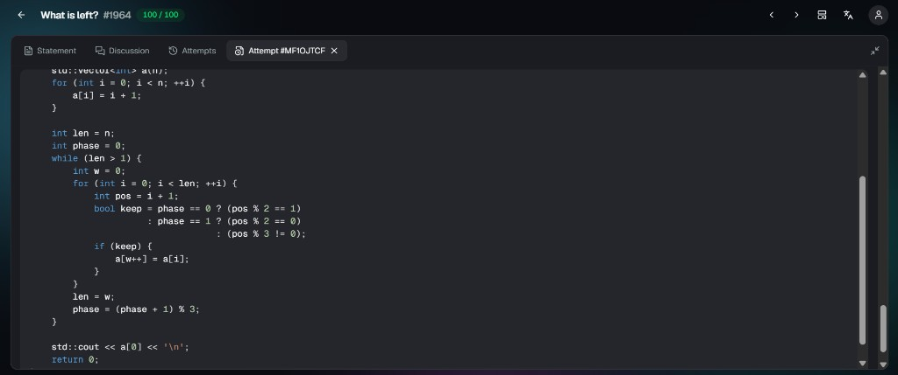

## Run it on Eolymp

Compiler: **C++**

Open [What is left? #1964](https://eolymp.com/problems/1964), choose **C++** as the compiler, paste the program below, and run it. For the sample, use input `10`. The program prints `3`.

```cpp
#include <iostream>
#include <vector>

int main() {
    std::ios::sync_with_stdio(false);
    std::cin.tie(nullptr);

    int n;
    if (!(std::cin >> n)) {
        return 0;
    }

    std::vector<int> a(n);
    for (int i = 0; i < n; ++i) {
        a[i] = i + 1;
    }

    int len = n;
    int phase = 0;
    while (len > 1) {
        int w = 0;
        for (int i = 0; i < len; ++i) {
            // The array is 0-based; the problem numbers positions from 1.
            int pos = i + 1;
            bool keep = phase == 0 ? (pos % 2 == 1)  // odd positions stay
                      : phase == 1 ? (pos % 2 == 0)  // even positions stay
                                   : (pos % 3 != 0); // positions divisible by 3 go
            if (keep) {
                // Compact kept values to the front, so the next pass
                // renumbers positions from 1 over the remaining prefix.
                a[w++] = a[i];
            }
        }
        len = w;
        phase = (phase + 1) % 3;
    }

    std::cout << a[0] << '\n';
    return 0;
}
```

This submission scored **100/100** on Eolymp. The solution uses array manipulation: the numbers stay in one vector, and each pass keeps the surviving values in that same array.



The source file is [CPP/main.cpp](main.cpp). It stores `1..n` in a vector and filters that array in place. Each index `i` is turned into a 1-based position `i + 1`. Kept values are written back to the front of the vector, so the next pass numbers those positions from 1. The loop stops when one value remains.
