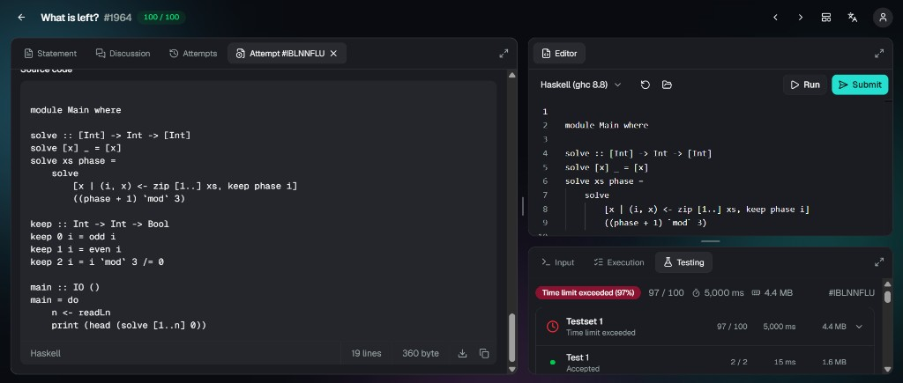

# What is left?

[What is left? #1964](https://eolymp.com/problems/1964)

Numbers from 1 to `n` are written in a row. Their positions start at 1. Three passes repeat until one number is left:

1. Remove every number in an even position.
2. Number the remaining values from 1 again, then remove every number in an odd position.
3. Number the remaining values from 1 again, then remove every number in a position divisible by 3.

The next pass is even positions again, then odd positions, then positions divisible by 3.

**Input.** One integer `n` (`1 ≤ n ≤ 10^8`).

**Output.** The last remaining number.

**Sample.** Input `10`, output `3`.

**Limits.** 5 seconds, 512 MB.

## Run it on Eolymp

Compiler: **Haskell (ghc 8.8)**

Open [What is left? #1964](https://eolymp.com/problems/1964), choose **Haskell** as the compiler, paste the program below, and run it. For the sample, use input `10`. The program prints `3`.

```haskell
module Main where

solve :: [Int] -> Int -> [Int]
solve [x] _ = [x]  -- one value left
solve xs phase =
    solve
        -- zip [1..] numbers positions from 1 on the current list.
        -- The next call sees only the kept values, so positions start at 1 again.
        [x | (i, x) <- zip [1..] xs, keep phase i]
        ((phase + 1) `mod` 3)

keep :: Int -> Int -> Bool
keep 0 i = odd i             -- odd positions stay
keep 1 i = even i            -- even positions stay
keep 2 i = i `mod` 3 /= 0    -- positions divisible by 3 go

main :: IO ()
main = do
    n <- readLn
    print (head (solve [1..n] 0))
```

This submission scored **97/100** on Eolymp. The solution filters a list: `zip [1..]` numbers the current values from 1, and each pass keeps the positions for that phase. The last test set exceeded the 5 second limit.



The source file is [Main.hs](Main.hs).
